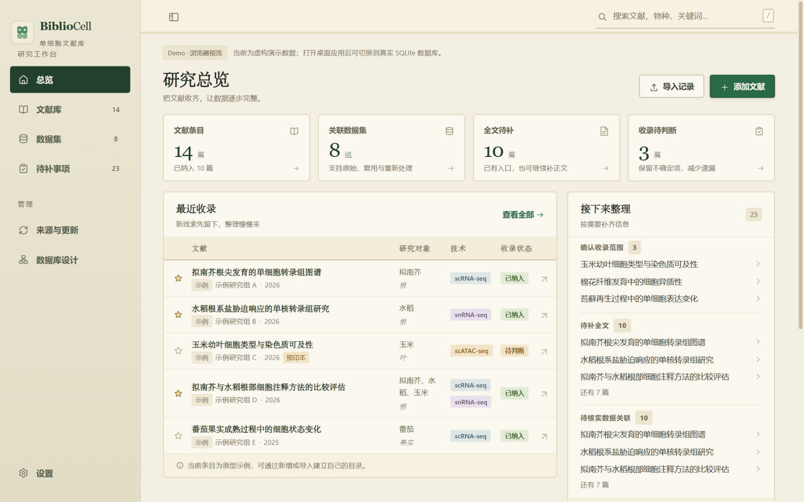
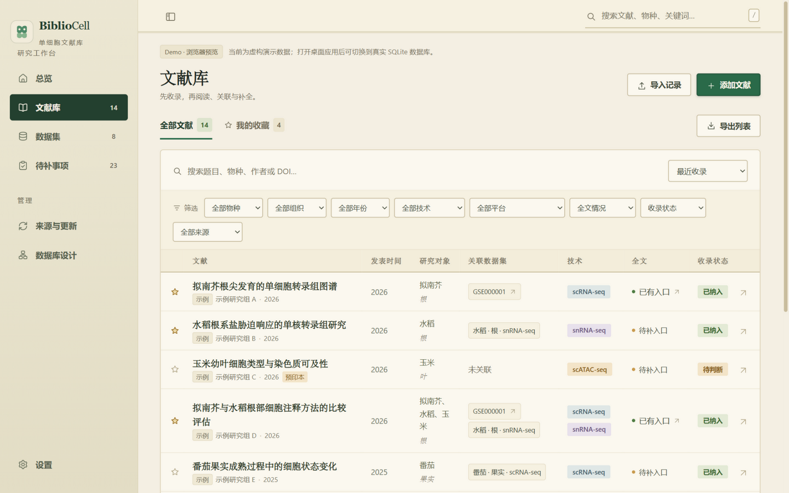
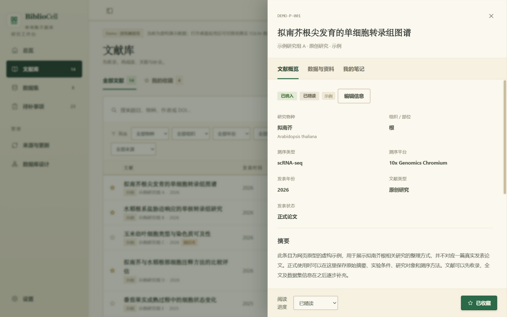
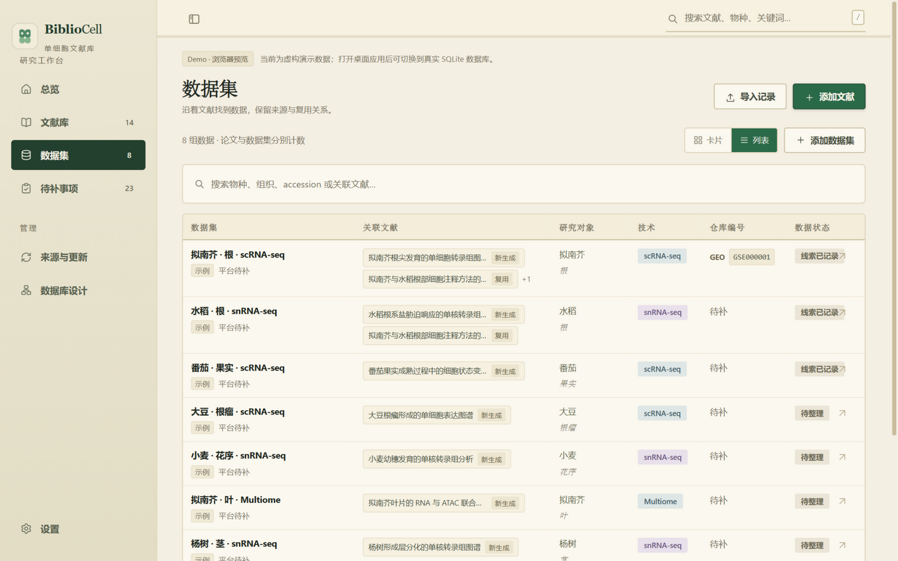
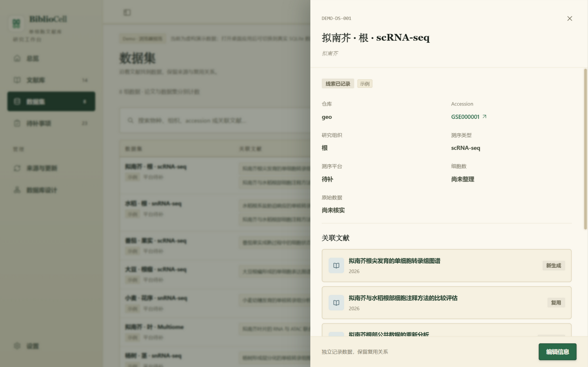
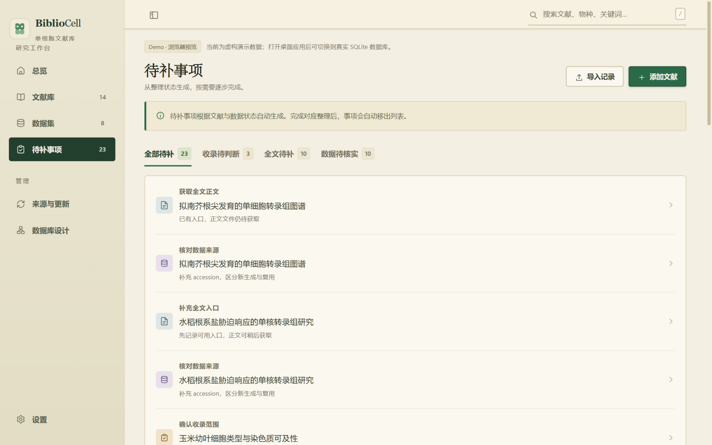

# BiblioCell

基于原始网页原型开发的 Go 桌面应用，使用 [mygo](https://github.com/egoist/mygo) 提供原生窗口和类型化 Go ↔ TypeScript 调用，使用纯 Go SQLite 保存正式数据。

## 界面预览

在线体验（Demo 数据，浏览器预览版，修改只保存在你自己的浏览器里）：**https://xuzhougeng.github.io/BiblioCell/**

| 总览 · 收录与整理进度 | 文献库 · 筛选、排序与分页 |
|:---:|:---:|
|  |  |
| **文献详情 · 摘要与收录判断** | **数据集 · 仓库编号与关联文献** |
|  |  |
| **数据集详情 · Accession 直达仓库** | **待补事项 · 按整理状态生成** |
|  |  |

## 两种数据模式

应用默认启用 **Demo 模式**：

- 展示明确标记的虚构文献、数据集与附件。
- 修改保存在浏览器 `localStorage`，不会写入正式数据库。
- 用于体验页面和交互。

在左下角 **设置** 页面关闭 **Demo 演示模式** 后进入 **真实数据库模式**：

- 从本机 `bibliocell.sqlite` 加载文献，初始数据库为空。
- 支持文献新增、编辑、笔记、标签、收藏、阅读进度与收录状态。
- 一篇文献可记录多个物种（学名 + 中文名）、多个组织、多种测序类型（scRNA-seq / snRNA-seq / scATAC-seq 等）、多个测序平台（10x Genomics Chromium / BD Rhapsody 等）和多种文献类型（原创研究 / 方法研究 / 综述 / 相关资料），筛选时按"包含其中一项"匹配。
- 数据集支持真实新增、编辑、文献关联、多物种、多组织、多测序类型、多平台、仓库 accession、整理状态、可用性和备注。
- 数据集仓库编号规范化存入 `repository_records` 和 `dataset_repositories`；文献角色存入 `paper_datasets`，保存时保留关联证据和人工核验状态。
- Demo 与正式数据完全隔离，切换模式不会复制或清空任何一边的数据。
- 文献详情的“数据与资料”可导入全文和补充材料：文件复制到存放文件夹的 `papers/`，原文件保持不动，导入全文后文献状态自动变为“已保存文件”。文件按资源 ID 命名（如 `papers/R-3fa9….pdf`），原文件名保留为标题，这样跨系统复制不受文件名编码和非法字符影响。同一文献重复导入相同内容不会多存一份。移除时文件进废纸篓。
- 文献详情显示 agent 记录的证据，可逐条确认或驳回；文献与数据集的关联、数据集的仓库编号都可以逐条核实。文献列表可按来源筛选。
- 资料链接和 JSON 导入目前只在 Demo 中开放。

## 设置

左下角 **设置** 页面提供：

- **Demo 演示模式**：切换 Demo 与真实数据库，切换时重新加载页面，不复制或合并数据。
- **数据存放位置**：选择一个文件夹，SQLite 数据库（`bibliocell.sqlite`）和文献文件（`papers/`）都保存在里面。通过原生目录对话框选定后立即切换；也可输入绝对路径，点“保存设置”后切换。切换前先试打开新文件夹，打不开就报错，设置和当前数据库都不变；打得开就自动重启过去。应用不会移动或覆盖旧数据，所选文件夹没有数据库时会创建空库。
- **界面字号**：12–20px，拖动时实时预览，保存后跨重启保留。缩放覆盖导航、表格、详情抽屉和笔记等固定字号，不改变面板宽度。
- **外部 AI · MCP**：集中显示连接地址、工具和 Schema 资源，可查看、复制、自定义或重新生成 Bearer Token。Token 修改在重启后生效。
- **AI 模型**：内置助手使用的模型服务，见下文“内置 AI 助手”。
- 桌面左侧边栏可折叠为图标栏，折叠状态保存在本机；移动端使用抽屉式导航。

设置保存在 mygo 用户数据目录的 `settings.json`。Windows 默认配置文件为 `%APPDATA%\BiblioCell\settings.json`，默认存放文件夹为同一目录。页面分别显示配置的文件夹和本次运行实际使用的文件夹。

存放文件夹可以整体迁移：退出应用后把它复制或移动到其他位置（包括其他电脑），在设置中选择新位置即可继续使用。数据库内不保存文件夹位置，附件的 `resources.local_path` 只存相对存放文件夹的路径，读取时拒绝任何跳出该文件夹的路径。字号、MCP Token 和来源凭证属于本机偏好，保存在 `settings.json`，不随文件夹迁移。

旧版设置中的 `databasePath` 会在启动时自动转换为存放文件夹。如果数据库用了其他文件名，会在原文件夹内改名为 `bibliocell.sqlite`；同名文件已存在时不覆盖，保留旧设置并改用默认文件夹，需要手动处理。

从旧版 PlantCell Library 升级时，应用会在首次启动时自动把 `%APPDATA%\PlantCell Library` 中的 `settings.json`、`mcp-token` 和 `plantcell.sqlite` 一次性迁入 `%APPDATA%\BiblioCell`，默认数据库同时更名为 `bibliocell.sqlite`。自定义位置的数据库留在原文件夹，不会被移走。

## 内置 AI 助手

左侧 **AI 助手** 页面内置一个极简的 agent loop：把你的话发给配置好的模型，模型要调用工具就在本地执行，把结果交回去，直到它用文字作答或达到步数上限。工具就是上面的 MCP 工具集，在进程内直接连接（不经过网络和 Token），所以外部 AI 和内置助手看到的是同一套能力和同一条规则：收录判断与核实仍由人在详情页决定。

模型服务在 **设置 · AI 模型** 配置，按接口协议而不是厂商区分：

- **Anthropic Messages**：`POST {地址}/v1/messages`，`x-api-key` 认证。默认地址 `https://api.anthropic.com`，默认模型 `claude-opus-5-5`。
- **OpenAI Chat Completions（兼容）**：`POST {地址}/chat/completions`，Bearer 认证。默认地址 `https://api.openai.com/v1`；DeepSeek、通义千问、Ollama（`http://localhost:11434/v1`）、vLLM 等填各自地址和模型名即可。

还可以设置**思考强度**（low / medium / high / xhigh / max，默认跟随服务；Anthropic 发送 `output_config.effort`，OpenAI 兼容协议发送 `reasoning_effort`，xhigh 与 max 都按 high 发送，老模型不支持时保持“服务默认”）、单次运行的步数上限（默认 20）和单次回复的 token 上限。Key 和地址只保存在本机 `settings.json`，修改后下一次对话生效，无需重启。

对话在每轮回复结束后自动保存到数据库（`agent_conversations` 表，随存放文件夹迁移）；标题栏的「历史对话」弹窗可以重新打开或删除以前的对话，「新对话」另起一段。助手的回复按 Markdown 渲染（标题、列表、代码、表格、链接），模型返回的思考摘要可展开查看；每次工具调用都显示在对话中，可展开查看参数和返回。运行中可以继续输入，发送的消息进入队列，当前一轮结束后按顺序自动发出；排队中的消息可以在队列里直接修改或移除，发送后光标留在输入框。

命令行同样可用：

```bash
BiblioCell settings set -ai-protocol openai -ai-base-url http://localhost:11434/v1 -ai-model qwen3 -ai-effort medium
```

```bash
BiblioCell agent "库里有多少篇还没判断收录的文献？"
```

`agent` 命令把工具调用打印到 stderr，最终结果（完整对话、回复、步数、token 用量）以 JSON 打印到 stdout。

## 更新与来源

真实数据库模式下，“更新与来源”页面可以保存每个来源的启用状态、检索式和单次结果上限（1–100），手动运行同步，也可以开启定时自动更新：

- **PubMed**：NCBI E-utilities 检索与 XML 元数据，保留 PMID、DOI、作者和摘要。
- **Europe PMC**：核心文献元数据检索。
- **Crossref**：书目关键词检索，保存 DOI 和出版信息。
- **bioRxiv**：扫描最近 30 天的预印本，在本地按题目、摘要和分类匹配关键词。
- **GEO / SRA / ENA**：可选择仓库，首次见到的记录新建为“待整理”数据集，保存 accession、标题、物种和官方页面，不自动关联文献。已有数据集持有同一 accession 时跳过。
- **CNCB GSA**：站点会要求浏览器安全检查，因此仅提供官方手动入口，不绕过验证抓取。

来源配置窗口里可以填写提高限额的凭证，都是选填，修改后下一次同步生效：

- **NCBI API Key**：PubMed 和 GEO / SRA 共用，请求上限从每秒 3 次提高到 10 次。ENA 不使用。
- **联系邮箱**：在 Crossref 配置中填写。作为 `mailto` 发送给 Crossref，进入 polite 池；Unpaywall 查询全文时也要用它。
- Europe PMC、bioRxiv、ENA 未接入凭证。

凭证保存在本机的 `settings.json`，不写入数据库，不随存放文件夹迁移，也不会通过 MCP 或 `sql` 读到。命令行用 `settings set -ncbi-api-key KEY -contact-email EMAIL` 设置。

文献详情的“资料”页可以点“获取开放全文”，agent 用 MCP 的 `fetch_fulltext`，命令行用 `papers fetch ID`。按 DOI 或 PMID 依次尝试：

1. **PMC 开放获取子集**：经 Europe PMC 查到 PMCID，再从 NCBI 公开的 S3 存储桶下载。
2. **Unpaywall**：遍历它列出的开放 PDF 地址，需要联系邮箱。

只接受 https 链接和真正的 PDF，单个文件上限 200 MiB，保存时记录来源地址和许可证。已有全文的文献不会重复下载。Europe PMC 和 PMC 网页的 PDF 入口有人机验证，出版社网站也可能拦截，这些情况都按失败处理，不会绕过；订阅内容和 Sci-Hub 一类渠道不接入，需要时手动导入。

自动更新默认关闭，此时只有点击“同步”才会访问远程公开 API。开启后，桌面应用运行期间每分钟检查一次，按设定频率逐个更新已启用的来源：

- 每个来源从自己最近一次运行起算，手动同步也算一次；应用关闭期间错过的更新在下次启动时补跑。失败的来源最多一小时后重试。
- 同一时间只运行一次更新。手动、定时和命令行的更新都在数据库里抢同一个运行名额，抢不到时立即返回“正在运行”，不排队。
- 页面显示上次和下次更新时间、各来源最近一次运行的新增与跳过合计，以及失败原因。设置保存在数据库中，随存放文件夹一起移动。`serve` 模式不运行定时更新。

去重在写入事务里完成，手动同步、自动更新和 agent 导入共用同一套规则，按顺序匹配：

1. **见过的外部记录**：同一来源的同一外部 ID 始终归到首次匹配的文献。所以人工改过题目或 DOI、撤销导入删除过的文献，都不会被重新抓回来。
2. **DOI**：比较前统一转小写，去掉 `https://doi.org/`、`doi:` 等前缀和末尾标点。
3. **PMID**：去掉 `PMID:` 标签和 PubMed 链接。
4. **题目**：只比较小写字母和数字，忽略标点、连字符和标记。题目只在缺标识符时兜底：DOI 或 PMID 不同的、年份相差超过一年的都算两篇，所以预印本和正式发表版各占一条。

规范化后的 DOI、PMID 在 `paper_identifiers` 上有唯一约束。通过题目匹配到已有文献时，只补它缺的 DOI 或 PMID，便于其他来源直接命中。自动流程不会改动已有文献的元数据、笔记、标签、收录判断和阅读状态；人工判断过的文献连标识符也不补。

来源更新新增的文献和数据集都进入“需核对”：文献库和数据集页各有一个“需核对”标签页（文献库的这一页同时列出 agent 建议排除或建议核对的文献）。文献做出收录判断、数据集修改整理状态后自动移出，也可以在详情里直接点“核查完成”。手动添加、agent 导入的记录不进入；agent 修改记录不会把它移出。

升级到 schema v8 时，已有的 DOI 和 PMID 会改写成规范形式，并补上题目匹配键，不合并也不删除任何文献。如果改写后与另一篇文献冲突，这个写法会移到 `other` 命名空间，两篇都保留，是否为同一篇由人判断。

配置、来源记录快照、每次成功/失败的运行记录和最近成功时间均保存在正式 SQLite 数据库中。Demo 数据不会与同步结果混合。

## 外部 AI：MCP

桌面应用启动后在本机回环地址提供 Streamable HTTP MCP 服务。不开窗口时用 `./BiblioCell serve` 提供同一服务，适合由 agent 调度；两者默认用同一端口，只能运行一个，`serve -addr 127.0.0.1:PORT` 可换端口，只接受回环地址。


```text
http://127.0.0.1:37841/mcp
```

提供以下工具：

| 工具 | 用途 |
|---|---|
| `describe_library` | 获取 Schema 资源、字段枚举和导入规则 |
| `library_status` | 查看正式数据库状态与记录数量 |
| `list_papers` | 查询、搜索正式文献，不返回 Demo 数据 |
| `get_paper` | 按 ID 读取一篇文献及全部可编辑 metadata |
| `add_paper` | 向正式 SQLite 数据库添加一篇文献，已存在时报错，需要写权限 |
| `import_papers` | 原子批量导入最多 1000 篇文献，跳过已有文献并返回 `batchId`，支持 `dryRun`，需要写权限 |
| `update_paper` | 局部编辑未经人工确认的文献 metadata，或提出收录建议，保留未提供字段，需要写权限 |
| `delete_paper` | 按 `id` 永久删除单篇文献（含已审核记录）、笔记、相关证据和保存的附件副本；保留数据集与原始导入文件，需要写权限 |
| `undo_import` | 撤销一个导入批次，保留人已处理过的记录，需要写权限 |
| `list_datasets` / `get_dataset` | 查询、分页读取数据集及其仓库编号和文献关联 |
| `add_dataset` | 新建数据集；按 accession 或题目找到已有数据集时只补充新关联，需要写权限 |
| `update_dataset` | 局部编辑未经人工核实的数据集，需要写权限 |
| `link_dataset` | 记录文献与数据集的关联，必须附依据，需要写权限 |
| `add_evidence` | 按字段记录提取依据：摘录和来源，供人核对，需要写权限 |
| `list_evidence` | 读取证据及人的判断 |
| `attach_file` | 把存放文件夹 `inbox/` 中的文件移入文库并挂到文献上，需要写权限 |
| `fetch_fulltext` | 通过 PMC 和 Unpaywall 查找开放获取 PDF 并保存，需要写权限 |
| `list_files` | 列出文献的附件，路径相对存放文件夹 |

`list_papers` 可按 `query`、`screening`、`source`、`batchId`、`needsReview` 筛选，用 `limit`（最大 500）和 `offset` 翻页，`total` 是匹配总数。`list_datasets` 同样分页。

### MCP 权限

- **无认证**：只读，可调用所有读取工具（`describe_library`、`library_status`、`list_*`、`get_*`），并读取 Schema 资源。
- **Bearer Token 认证**：额外允许标注“需要写权限”的工具。
- 无 Token 的写调用会被拒绝；错误 Token 返回 HTTP 401。
- Token 是应用首次启动时生成的 256 位随机密钥。可以在“设置 → 外部 AI · MCP”中查看、复制、自定义或重新生成；自定义 Token 保存在 `settings.json`，修改后重启生效。Token 不会通过 MCP 暴露。
- `describe_library` 返回当前连接的 `accessRole`（`read-only` 或 `read-write`）和 `canWrite`。

### 人工核查

收录判断只由人做出，agent 只能提议：

- `screening`（`pending` / `included` / `excluded` / `uncertain`）只记录人的决定，MCP 和命令行都不能写入。agent 用 `proposedScreening` 和 `proposedReason` 提出建议，提议排除时必须写理由。
- 建议显示在“待补事项”和文献详情的“收录判断”里，人可以采纳、忽略，或自行选择。做出决定后建议随即失效。
- 数据库记录真实来源：只有人的决定会把 `screening_method` 写成 `human` 并记下 `screening_reviewed_at`，接口里对应 `reviewedAt`。未决定的文献是 `unreviewed`。
- 文献一经人工确认，`update_paper` 就只接受建议，不再允许修改 metadata。把判断改回“待判断”即可解除。数据集同理：经人工核实后 `update_dataset` 被拒绝，改回其他状态即可解除。
- 证据（`add_evidence`）、数据集仓库编号和文献关联由 agent 记录，只有人能在桌面端确认、驳回或核实，MCP 和命令行没有对应入口。证据的判断 agent 可以读到；已核实的关联不会被 agent 改动。同一条证据重复提交不会重置人的判断。证据不影响字段本身：驳回只表示人不认可这条依据。
- 移除文件时，来自该文件的证据一并删除。
- 桌面端只保存你改动的字段：agent 在窗口打开期间写入的内容不会被覆盖。同一篇文献的同一字段被两边同时修改时，这次改动不保存并提示，窗口重新加载。窗口回到前台时自动读取最新数据，打开详情或弹窗时不刷新。
- 从旧版本升级时，来源为 MCP 或 CLI 的已判断文献分不清是谁判断的，会退回“待判断”，原判断保留为建议，可一键采纳。其他已判断文献记为人工确认。
- 这是防止误操作的边界，不是安全边界：`sql` 命令和直接修改 SQLite 文件仍可绕过。

### Agent 工作流

1. `describe_library` 读取规则和 `inboxPath`；一次运行用同一个 `batchId`。
2. `import_papers` 导入文献，已有文献被跳过并列在 `skipped`，可以放心重跑。`add_dataset` 同样可重跑。
3. 把 PDF 放进 `inboxPath`，再用 `attach_file` 挂到文献上。只能读取 `inbox/` 内的文件，`..` 和指向外部的符号链接都会被拒绝。文件移入文库后从 inbox 消失。
4. `add_dataset` / `link_dataset` 记录数据集和关联，`add_evidence` 记录每个字段的摘录和来源，`update_paper` 提交 `proposedScreening`。
5. 人在桌面端核查。agent 用 `list_papers` 的 `needsReview` 和 `list_evidence` 查看进度和判断。
6. 这批导入错了就 `undo_import`：删除未经人处理的文献、数据集和它们的文件副本；人已确认、收藏、阅读或核实过的记录保留并列在 `kept`。

`update_paper` 使用 `id` 和 `patch`。例如只修改期刊时传入 `{"id":"P-...","patch":{"journal":"New journal"}}`，未提供的 DOI、作者、笔记等字段保持不变；`clearYear: true` 可以将年份清空。多值字段（`species`、`organs`、`modalities`、`platforms`、`articleTypes`）以数组整体替换，例如 `{"patch":{"platforms":["10x Genomics Chromium","BD Rhapsody"]}}`，空数组表示清空。

### MCP 自描述与 Schema

AI 客户端可以通过标准 MCP 能力发现接口，不需要在提示词里硬编码字段：

- `tools/list` 返回每个工具的 `inputSchema` 和 `outputSchema`。
- `bibliocell://schema/paper` 提供单篇文献的 JSON Schema。
- `bibliocell://schema/sql` 提供完整 SQLite 表、约束、索引和视图 DDL。
- `describe_library` 汇总必填字段、状态枚举、导入规则和上述资源入口。

推荐导入流程：先调用 `describe_library`，读取文献 Schema，再用 `import_papers` 设置 `dryRun: true` 校验，最后将 `dryRun` 设为 `false` 正式导入。每批最多 1000 篇，任何一条无效都会回滚整个批次；按 ID、DOI、PMID、题目识别出的已有文献被跳过，不会覆盖旧记录。

通用 MCP 客户端配置示例（具体字段以所用 AI 客户端为准）：

```json
{
  "mcpServers": {
    "bibliocell-library": {
      "url": "http://127.0.0.1:37841/mcp",
      "headers": {
        "Authorization": "Bearer <MCP_TOKEN>"
      }
    }
  }
}
```

省略 `headers` 即为只读连接；需要导入或编辑时，将 `<MCP_TOKEN>` 替换为应用页面显示的 Token。

MCP 始终操作正式数据库，与界面是否开启 Demo 无关。MCP 新增或编辑的文献在窗口回到前台时可见。服务仅监听 `127.0.0.1`，不要将端口转发到局域网或公网。

## 命令行

同一个可执行文件也可以当命令行工具用，不开窗口，直接读写正式 SQLite 数据库和 `settings.json`。第一个参数是已知子命令时走命令行，否则照常启动桌面应用。输出一律是 JSON，方便接 `jq`。

```bash
./BiblioCell status
./BiblioCell papers list -q "Arabidopsis" -limit 20
./BiblioCell papers get P-xxxx
echo '{"title":"...","doi":"10.1000/x"}' | ./BiblioCell papers add
./BiblioCell papers import -f papers.json -dry-run
echo '{"journal":"Cell"}' | ./BiblioCell papers update P-xxxx
./BiblioCell papers attach P-xxxx paper.pdf
./BiblioCell papers attach P-xxxx -type supplement table-s1.xlsx
./BiblioCell papers files P-xxxx
./BiblioCell papers list -needs-review -batch run-1 -limit 100 -offset 100
./BiblioCell papers undo run-1

# 永久删除单篇文献，成功返回 {"id":"P-...","deleted":true}
./BiblioCell papers delete P-...
./BiblioCell datasets list -status pending
./BiblioCell datasets get DS-xxxx
echo '{"title":"...","repositories":[{"repository":"geo","accession":"GSE1"}]}' | ./BiblioCell datasets add
echo '{"status":"identified"}' | ./BiblioCell datasets update DS-xxxx
echo '{"paperId":"P-xxxx","role":"generated","evidenceText":"..."}' | ./BiblioCell datasets link DS-xxxx
./BiblioCell evidence list -paper P-xxxx
./BiblioCell evidence add -f claims.json
./BiblioCell sources list
./BiblioCell sources set pubmed -enabled -query "plant single cell" -max 50
./BiblioCell sources sync pubmed
./BiblioCell sources auto -enabled=true -hours 24
./BiblioCell settings get
./BiblioCell settings set -font-size 16 -storage /abs/path/folder -mcp-token <TOKEN> -ncbi-api-key <KEY> -contact-email <EMAIL>
./BiblioCell mcp
./BiblioCell serve -addr 127.0.0.1:37841
./BiblioCell sql "select id, title from papers order by added_at desc limit 5"
```

- `papers add` / `import` / `update` 和 `datasets`、`evidence` 使用与 MCP 相同的字段和校验规则；`import` 一批原子提交，`-batch` 指定批次，`-dry-run` 只校验不写入。
- `papers attach` 由本机命令行执行，可以读取任意路径；MCP 的 `attach_file` 只能读 `inbox/`。
- `papers attach` 把文件复制进存放文件夹的 `papers/`，默认记为全文，`-type supplement` 记为补充材料。
- `sql` 直接执行任意语句：`SELECT` / `WITH` / `PRAGMA` 打印行，其他语句打印受影响行数。它绕过应用层校验，改数据前先备份。
- 数据目录按 `-data-dir`、`$BIBLIOCELL_DATA_DIR`、应用默认用户数据目录的顺序确定；在 macOS 上 `.app` 包内和 `go run` 的默认目录名相同，命令行与桌面应用看到的是同一个库。
- `settings set` 修改的存放文件夹和 MCP Token 在下次启动桌面应用后生效。
- 桌面应用运行中也可以同时使用命令行，SQLite 自带锁，忙等 5 秒后报错。

## 目录

```text
BiblioCell/
├── main.go                  # mygo 应用、窗口、SQLite 与 MCP 生命周期
├── service.go               # 暴露给前端的 Library 服务
├── cli.go                   # 命令行子命令：文献、来源、设置、原始 SQL
├── internal/library/
│   ├── store.go             # 数据库打开、迁移与完整性检查
│   ├── auth.go              # MCP 写权限 Token 的生成与持久化
│   ├── paper.go             # 正式文献 CRUD 与原型模型映射
│   ├── dataset.go           # 数据集 CRUD、仓库与文献关联
│   ├── source.go            # 来源配置、同步运行、去重与外部记录快照
│   ├── source_automation.go # 自动更新设置、到期判断与后台调度
│   ├── source_clients.go    # 文献公开 API 客户端与解析器
│   ├── source_repositories.go # GEO / SRA / ENA 仓库检索
│   ├── mcp.go               # 本机 MCP 服务与 AI 工具
│   ├── schema.sql           # 嵌入二进制的数据库结构 v5
│   └── *_test.go            # 数据库与 MCP 端到端测试
├── internal/settings/       # 设置校验、默认值与原子 JSON 持久化
├── src/
│   ├── main.ts              # 入口：Demo / 真实模式判断与启动
│   ├── app.ts               # 页面状态、渲染循环与事件委托
│   ├── model.ts             # 纯逻辑：筛选、待补事项、DOI 规范化、导入校验、CSV
│   ├── store.ts             # 持久化：SQLite（经 Go）与 localStorage（Demo）两种实现
│   ├── views.ts / drawer.ts / forms.ts / sources.ts / settings.ts  # 各页面、抽屉与弹窗
│   ├── ui.ts / icons.ts / shell.ts  # HTML 片段构造、图标与侧栏等静态外壳
│   ├── demo-data.ts         # 明确标记的虚构演示数据
│   ├── style.css            # 单一样式表（外壳与设置页 → 基础 → 组件）
│   └── mygo.ts              # mygo generate 生成的类型化客户端
├── tests/                   # node:test 纯逻辑测试（npm test）
├── public/                  # 图标、设计文档与可下载资料
├── resources/               # 应用图标
├── mygo.config.ts           # mygo 开发、构建和应用元数据
└── package.json             # Vite / TypeScript 前端工具链
```

## 开发环境

- Go 1.27.3 或更新版本（Go 1.26 可通过自动工具链下载运行）
- Node.js 与 npm
- Windows 10/11 的 WebView2；Windows 11 通常已内置

```bash
npm install
npm run dev
```

`mygo dev` 会生成 `src/mygo.ts`、启动 Vite，并打开桌面应用。普通浏览器也可以通过 `npm run dev:web` 预览 Demo，但无法连接 Go 后端、真实数据库或 MCP。`npm run typecheck` 做 TypeScript 严格检查，`npm test` 运行 `tests/` 下的纯逻辑测试（Node 22.6+ 自带类型剥离，无需额外依赖）。

## 验证与构建

```bash
CGO_ENABLED=0 go test ./...
npm run typecheck
npm run build
```

测试覆盖数据库初始化与重开、文献编辑、数据集多值往返、共享仓库记录保护、文献关联证据保留、来源配置持久化、跨来源去重与人工整理保护、定时更新到期判断与补跑、同一时间单次运行、已有数据迁移、失败运行记录、公开 API 可选冒烟测试、MCP 新增记录不被界面保存覆盖、真实 MCP 客户端调用、工具与资源 Schema、`dryRun` 校验、失败批次整体回滚、无认证只读、错误 Token 拒绝、认证后的 metadata 局部更新，以及设置默认值、校验和持久化。

需要实际访问公开来源时，可额外运行 `BIBLIOCELL_LIVE_TEST=1 go test ./internal/library -run TestRemoteConnectorsLive -v`；默认测试不会访问网络。

打包结果位于 `build/`，前端构建结果位于 `dist/`。正式数据库保存在 mygo 的用户数据目录，不在源码目录中。
