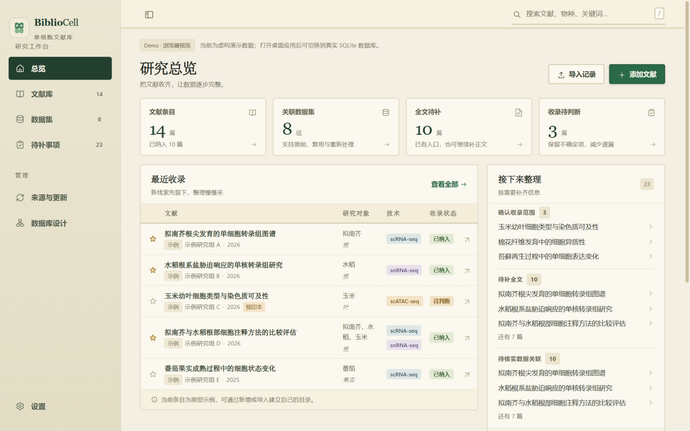
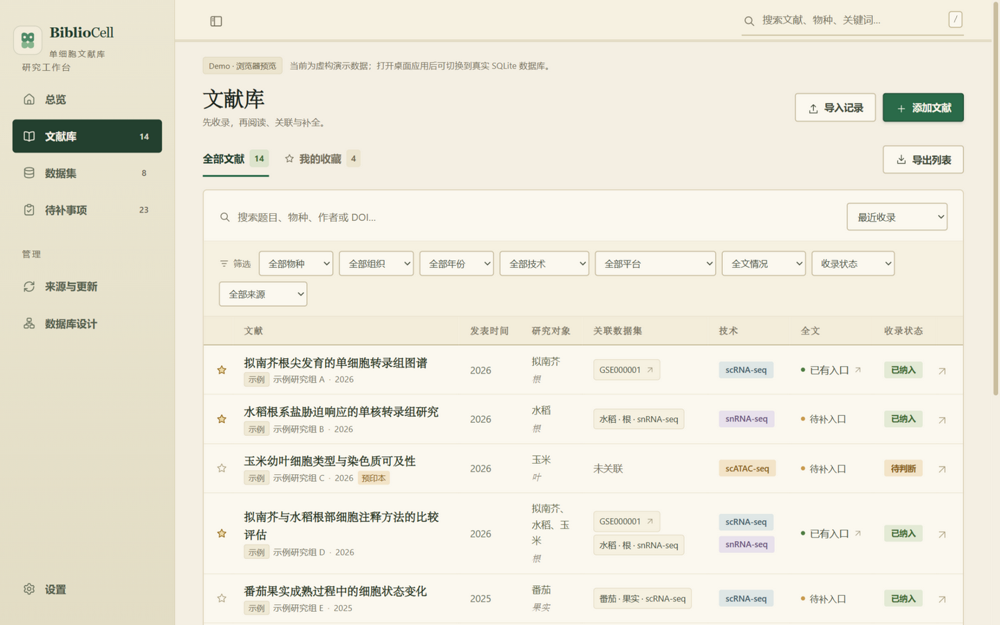
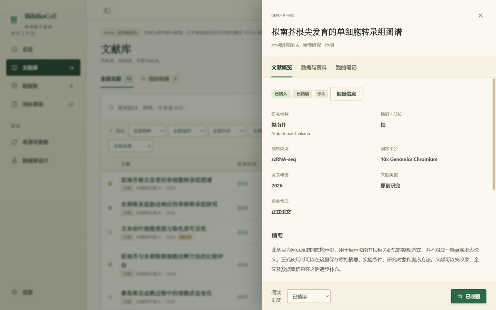
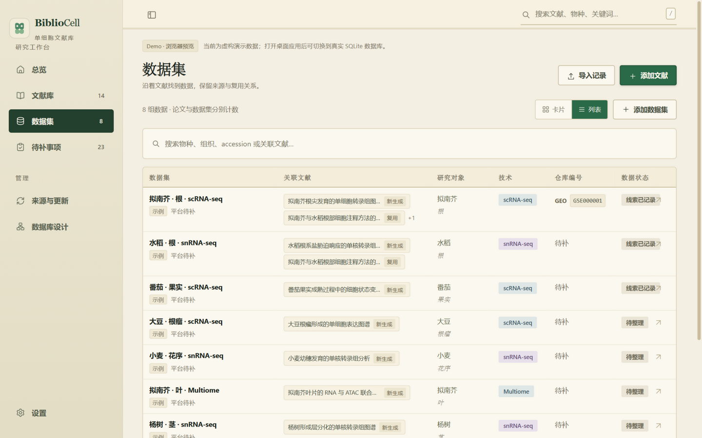
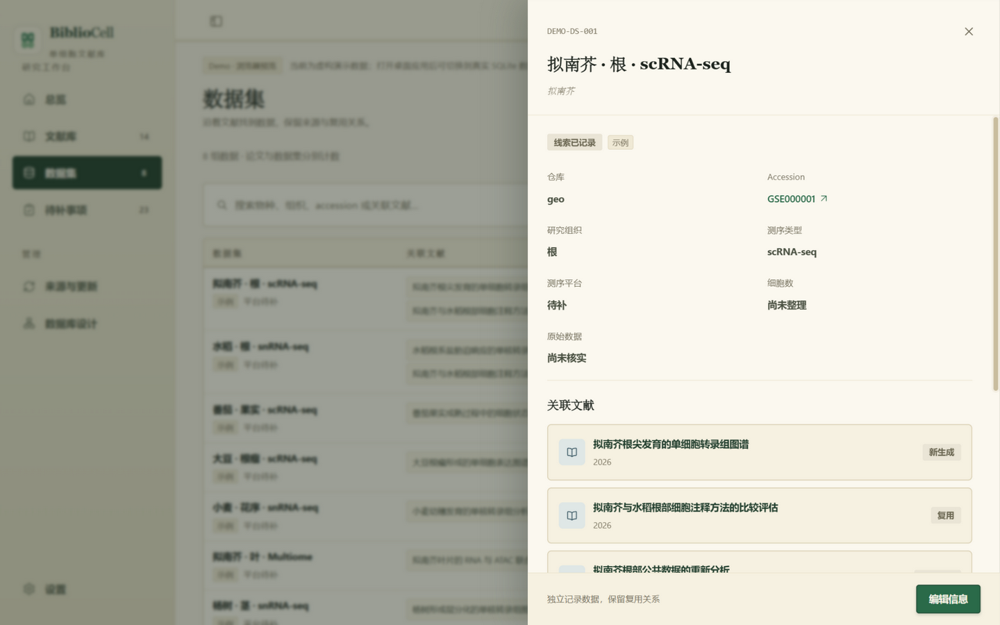
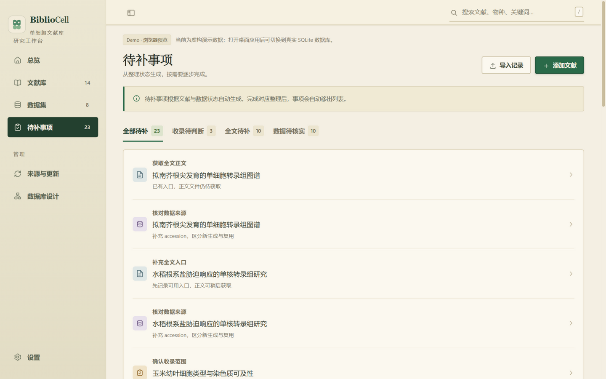
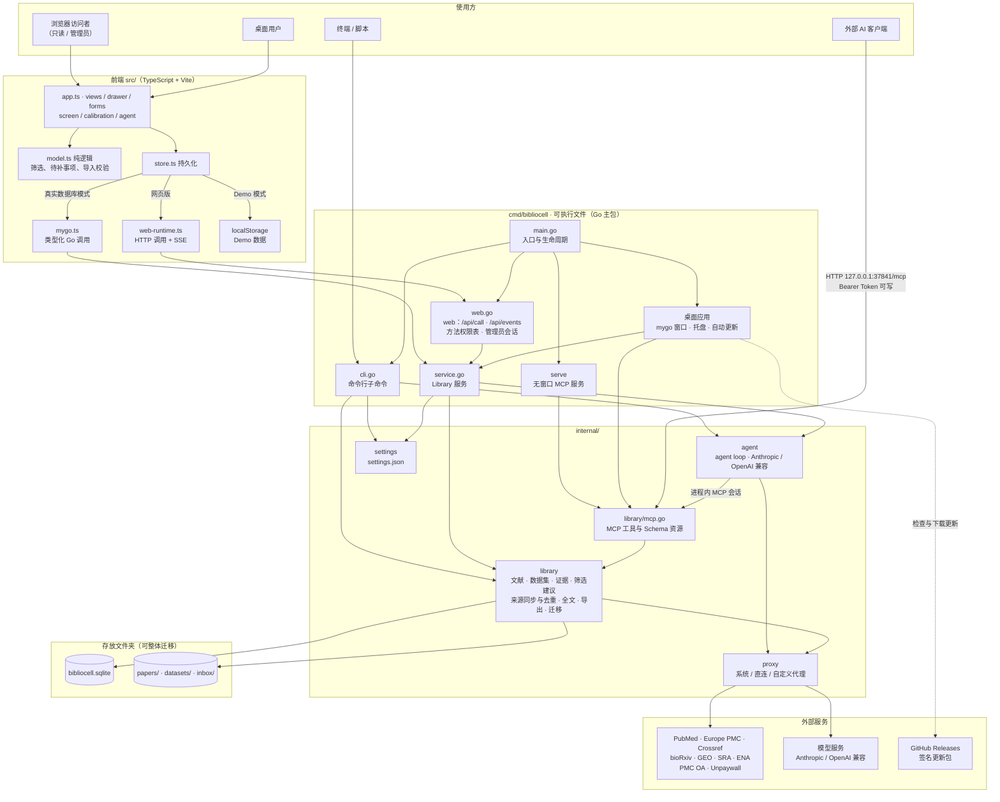

# BiblioCell

基于原始网页原型开发的 Go 桌面应用，使用 [mygo](https://github.com/egoist/mygo) 提供原生窗口和类型化 Go ↔ TypeScript 调用，使用纯 Go SQLite 保存正式数据。

## 界面预览

在线体验（Demo 数据，浏览器预览版，修改只保存在你自己的浏览器里）：**https://xuzhougeng.github.io/BiblioCell/**

| 总览 · 收录与整理进度 | 文献库 · 筛选、排序与分页 |
|:---:|:---:|
|  |  |
| **文献详情 · 摘要与收录判断** | **数据集 · 仓库编号与关联文献** |
|  |  |
| **数据集详情 · Accession 直达仓库** | **待补事项 · 按整理状态生成** |
|  |  |

## 下载安装

正式版本在 [GitHub Releases](https://github.com/xuzhougeng/BiblioCell/releases) 发布：

- **macOS**：`bibliocell-<版本>.dmg`，Apple Silicon 与 Intel 通用。已用 Developer ID 签名并经 Apple 公证，打开后把 BiblioCell 拖进“应用程序”即可。
- **Windows**：`bibliocell-setup-<版本>-amd64.exe`，带 Authenticode 签名的安装包，安装到当前用户目录，不需要管理员权限。运行需要 Microsoft Edge WebView2（Windows 11 自带）。

装好之后不用再手动下载：应用启动后和每隔 6 小时检查一次新版本，发现后在后台下载并校验签名，下好后顶栏左侧出现“↑ 更新”，点一下确认即重启换上新版本；不点也没关系，下次打开时会自动换上。悬停时出现的 × 可以隐藏这个版本的提示。0.2.0 及更早的版本还没有这个功能，需要手动下载安装一次之后的版本。

发布流程见[发布](docs/release.md)。

## 功能概览

- **文献库与数据集**：记录文献的物种、组织、测序类型、平台和收录判断，数据集的仓库 accession、整理状态与文献关联；Demo 与正式数据完全隔离。→ [数据模式与数据集资源](docs/data.md)
- **文献跟踪**：从 PubMed、Europe PMC、Crossref、bioRxiv、GEO / SRA / ENA 同步新文献和数据集，跨来源去重，可定时自动更新、合并预印本、获取开放全文。→ [文献跟踪](docs/literature-tracking.md)
- **内置 AI 助手**：Anthropic / OpenAI 兼容协议，AI 筛选建议与人工判定对照，全文检索与可跳转到 PDF 原文的引用。→ [内置 AI 助手](docs/ai-assistant.md)
- **外部 AI：MCP**：本机 Streamable HTTP MCP 服务，只读或带 Token 写入；收录判断始终由人做出。→ [MCP](docs/mcp.md)
- **导出**：BibTeX、CSV、进度报告、批量下载脚本等。→ [导出](docs/export.md)
- **命令行与网页版**：同一个可执行文件可作命令行工具，或作为内网只读网站运行。→ [命令行](docs/cli.md) · [网页版部署](docs/web-deployment.md)
- **设置**：存放文件夹可整体迁移，界面中英双语，可配置网络代理。→ [设置](docs/settings.md)

## 软件架构

同一个可执行文件按启动参数分成四种运行形态，共用 `internal/` 下的业务层和同一个存放文件夹：



- **桌面应用**（默认）：mygo 打开原生窗口，前端通过 `mygo.ts` 调用 `service.go` 上的 `Library` 方法；同时在本机回环地址启动 MCP 服务和来源定时更新，关闭窗口后可留在托盘后台运行。
- **命令行**（第一个参数是已知子命令）：不开窗口，直接读写同一个 SQLite 库和 `settings.json`，输出 JSON。
- **网页版**（`web`）：同一套前端改用 `web-runtime.ts` 经 `POST /api/call` 调用 `Library`，权限由服务端 `webMethodAccess` 判定。
- **MCP 服务**（`serve`）：只提供 MCP，供 agent 调度。内置 AI 助手复用同一套 MCP 工具，在进程内直连，所以内外 AI 的能力与规则一致。

源码目录说明见[开发指南](docs/development.md#目录)。

## 快速开始（开发）

```bash
npm install
```

```bash
npm run dev
```

需要 Go 1.27.3+、Node.js 与 npm；测试、构建与目录说明见[开发指南](docs/development.md)。

## 文档

完整文档在 [`docs/`](docs/README.md)：

- 使用：[数据模式与数据集资源](docs/data.md) · [设置](docs/settings.md) · [文献跟踪](docs/literature-tracking.md) · [内置 AI 助手](docs/ai-assistant.md) · [导出](docs/export.md)
- 集成与部署：[外部 AI：MCP](docs/mcp.md) · [命令行](docs/cli.md) · [网页版：内网部署](docs/web-deployment.md)
- 开发与维护：[开发指南](docs/development.md) · [数据库版本与迁移](docs/database-migrations.md) · [发布](docs/release.md)
